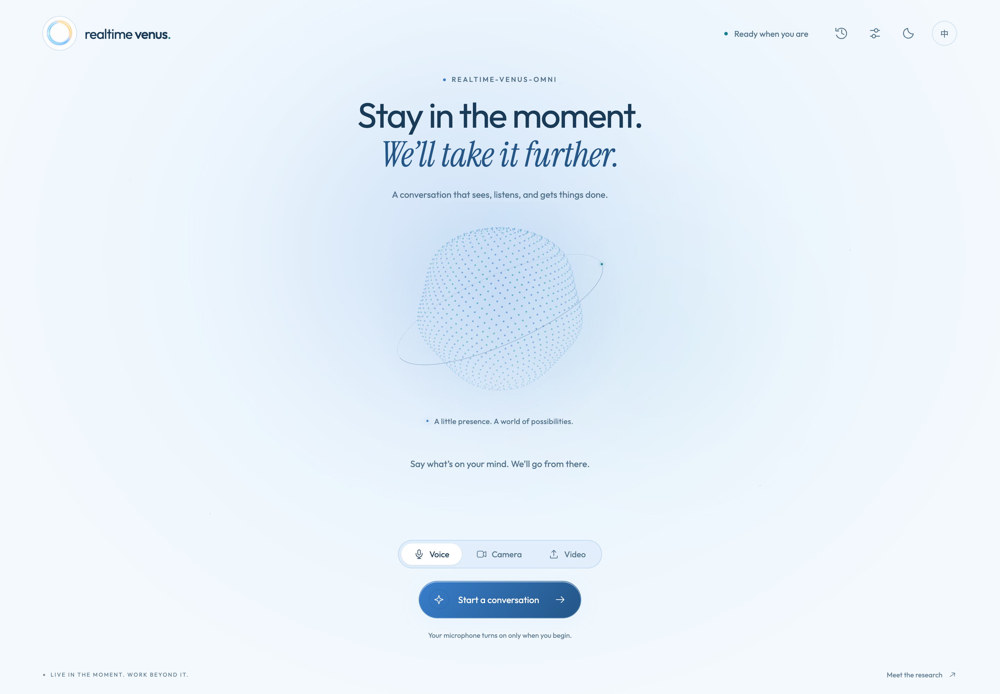

# Realtime-Venus Demo

**English** · [简体中文](README_ZH.md) · [Project overview](../README.md) · [Harness](../harness/README.md)

Browser demo with Realtime-Venus-Omni or Realtime-Venus-Audio and a Codex-backed Harness. Choose Audio for microphone/audio upload, or Omni for camera with microphone/video upload.

## Two loops, one conversation

<p align="center"><br /><sub>Figure 3 from the <a href="https://arxiv.org/pdf/2609.13814">paper</a>. The demo selects an Omni or Audio frontend at launch.</sub></p>

The selected frontend handles streaming media and speech in the **interaction loop**. In the **capability loop**, Harness executes `<delegate>...</delegate>` requests asynchronously and returns results through `<backend>...</backend>` for the frontend to speak.

## Service layout

| Component | Responsibility | Implementation |
| --- | --- | --- |
| Browser | Capture devices or upload audio/video, stream input, play speech, show task progress and downloads. | [`static/app.js`](static/app.js) |
| Web service · 8032 | Accept HTTP/WebSocket requests, own the browser session, and assemble model and Harness connections. | [`server/app.py`](server/app.py), [`server/resources.py`](server/resources.py) |
| Session host | Order media input, consume model output, schedule private feedback, and relay playback acknowledgments. | [`server/session.py`](server/session.py), [`VenusOmniServingHost`](../harness/bridge/host.py) |
| Model service · 8031 | Load the checkpoint, retain model state, run streaming inference, and generate native speech. | [`model/server.py`](model/server.py), [`model/adapter.py`](model/adapter.py) |
| Harness + Codex | Embedded task execution, progress, and result delivery. | [`server/resources.py`](server/resources.py), [Harness](../harness/README.md#architecture) |
| Containers and settings | Images, startup and saved configuration. | [`deploy/`](../deploy/), [`settings.py`](settings.py) |

The model service runs on a GPU server; every other component runs on your computer and calls the model's HTTP API over the network (for example a company VPN).

<p align="center"><br /><sub>The browser is the entry point for live media, task progress, and result downloads.</sub></p>

## Prepare

**GPU server (model).** A Linux server with an NVIDIA CUDA GPU, a working driver, Docker Engine with Compose, and the NVIDIA Container Toolkit (so containers can use the GPU). Download the complete checkpoint for your mode there following the [model download guide](../README.md#1-installation), retaining its model code, tokenizer, reference audio, and speech assets. The default downloader places it in `Realtime-Venus-Omni/` or `Realtime-Venus-Audio/` at the repository root, next to the `config.yaml` both checkpoints read; `MODEL_DIR` in `deploy/model/.env.example` points to that root.

**Your computer (web service, Harness, Codex).** macOS or Linux with Docker Desktop or Docker Engine; no GPU or checkpoint is needed — the tokenizer is read from the model server. The Codex backend requires network access and a one-time login inside the container.

<details>
<summary>Expected checkpoint layout</summary>

```text
Realtime-Venus-Omni/  # Or Realtime-Venus-Audio/
├── config.json
├── tokenizer.json / tokenizer_config.json
├── *.py                       # Checkpoint model code
├── model.safetensors          # Or all shards and their index JSON
└── assets/
    ├── HT_ref_audio.wav
    └── token2wav/
        ├── flow.yaml / flow.pt / hift.pt
        ├── campplus.onnx
        └── speech_tokenizer_v2_25hz.onnx
```

A nested `model_weight/model_weight/` layout is also recognized.

</details>

## Start

Each side is a Docker Compose project configured by the `.env` file next to its `compose.yaml`; see [Configuration files](#configuration-files) for every field.

1. **GPU server**, in `deploy/model`: `cp .env.example .env`, then set `MODEL_TYPE`, `MODEL_DIR` and `VENUS_MODEL_TOKEN` (generate the secret once with `python3 -c "import secrets; print(secrets.token_urlsafe(24))"`). Start the model; the first run builds the image:

   ```bash
   docker compose up -d
   ```

   Its port (`MODEL_PORT`, 8031 by default) must be reachable from your computer. On a shared server keep `.env` private with `chmod 600 .env`.

2. **Your computer**, in `deploy/web`: `cp .env.example .env`, then set `MODEL_URL` to the server's address (for example `http://10.194.99.8:8031`) and `VENUS_MODEL_TOKEN` to the same secret. Start the web service, then log in to Codex once:

   ```bash
   docker compose up -d
   ```

   ```bash
   docker compose exec web codex login --device-auth
   ```

   If the model server is unreachable, not ready, or rejects the token, the web container exits with that reason in `docker compose logs` and restarts until the model is available. While it is restarting, log in with `docker compose run --rm --entrypoint sh web -c 'mkdir -p "$CODEX_HOME" && codex login --device-auth'` instead.

**Both on one machine:** inside the web container `127.0.0.1` is the container itself, so set `MODEL_URL` to `http://host.docker.internal:8031` (Docker Desktop) or the machine's own address.

## Open on your computer

Open **[http://localhost:8032](http://localhost:8032)** and start a conversation.

| Input mode | What to do |
| --- | --- |
| **Audio · microphone** | Allow microphone access and listen through your local speakers. |
| **Audio · audio upload** | Upload WAV, MP3, M4A, FLAC, OGG or other audio, up to **200 MB**. |
| **Omni · camera** | Share the camera and microphone together; the page shows a live preview. |
| **Omni · video upload** | Choose Video and upload a local file, up to **200 MB**. Its soundtrack and sampled frames are streamed to the model. |

The side panel provides task progress, cancellation, and artifact downloads.

The model serves **one active conversation**. If the web service stops without closing it (crash, network loss), the model frees the slot after 15 seconds without requests. The page is published on `127.0.0.1` only, which browsers trust for camera and microphone.

**Latency.** Each second of conversation makes about three sequential requests to the model plus one output pull, all over the network. Round trips up to about 100 ms feel like a single-machine setup; above about 200 ms replies slow down and input can back up. Check from your computer with `curl -s -o /dev/null -w '%{time_total}\n' http://10.194.99.8:8031/healthz`, using your `MODEL_URL`.

## Configuration

### Configuration files

**Model server** (`deploy/model/.env`):

| Field | Default | Purpose |
| --- | --- | --- |
| `MODEL_TYPE` | `omni` | `omni`: camera with microphone and video upload; `audio`: microphone and audio upload. |
| `MODEL_DIR` | — (required) | Download root holding `config.yaml` and the checkpoint folders; the server picks the folder for `MODEL_TYPE`. Relative paths start with `./` or `../` and are relative to `deploy/model` (without the prefix, Compose creates an empty named volume). Mounted read-only. |
| `REFERENCE_AUDIO` | `assets/HT_ref_audio.wav` | Reference voice, relative to the selected checkpoint folder. |
| `MODEL_PORT` | `8031` | Port your computer uses to reach the model. |
| `MEMORY_MINUTES` | `40` | Omni video memory in minutes; unused by Audio. |
| `GPU_DEVICE` | `0` | GPU index. |
| `VENUS_MODEL_TOKEN` | — (required) | Shared secret; every request except `/healthz` must carry it. |
| `PYTHON_IMAGE` / `PIP_INDEX_URL` | `python:3.11.18-slim-trixie@sha256:6737…` / PyPI | Base image and package index for the build; point them at mirrors if needed. |

**Web service** (`deploy/web/.env`):

| Field | Default | Purpose |
| --- | --- | --- |
| `MODEL_URL` | — (required) | Model server address, for example `http://10.194.99.8:8031`. The model type and tokenizer are read from it at startup. |
| `VENUS_MODEL_TOKEN` | — (required) | The same secret as on the model server. |
| `WEB_PORT` | `8032` | The page opens at `http://localhost:<WEB_PORT>`; it is published on loopback only. |
| `MODEL_TIMEOUT_S` | `180` | Model request timeout in seconds. |
| `DATA_DIR` | `./data` | Settings (`harness.json`), Codex login (`codex/`) and task files. Relative paths start with `./` and are relative to `deploy/web`. |
| `GEMINI_API_KEY` | empty | Optional official Gemini key; it can also be entered in Settings. |
| `PYTHON_IMAGE` / `PIP_INDEX_URL` | `python:3.11.18-slim-trixie@sha256:6737…` / PyPI | Base image and package index for the build. |

After editing a `.env`, apply it with `docker compose up -d` in the same folder. To switch modes, change `MODEL_TYPE` on the server (the other checkpoint must be downloaded into the same root) and run `docker compose up -d` there, then `docker compose restart` in `deploy/web` so the web service reads the new model type.

**Harness settings** (`deploy/web/data/harness.json`) are written by the browser Settings panel on first save, starting from the defaults in the standalone package's [configuration file](../harness/config.json). They control Codex, routing, Polish (`responses`), multimodal, Gemini, workspace, progress feedback, execution/queue/delivery timeouts, component budgets, and the speaking length. See the [Harness guide](../harness/README.md#configuration-file) for each field; relative paths inside the file resolve from `deploy/web/data`.

The web container runs Codex's task sandbox (bubblewrap), which needs the `seccomp=unconfined` and `systempaths=unconfined` options set in `compose.yaml`; without them every task command fails. These options weaken the container's own isolation (every system call allowed, `/proc` unmasked), so the image runs as a non-root user and the page accepts only `localhost` / `127.0.0.1` host names; the sandbox keeps task commands inside the workspace. This setup is tested on macOS with Docker Desktop. On Linux hosts AppArmor may also block the sandbox (`apparmor=unconfined`, untested), and `DATA_DIR` must be writable by uid 1000.

### Browser settings

Task workspace starts empty. In Settings, enter a task directory before starting a conversation, for example `workspace`; relative paths are stored under `deploy/web/data` on your computer. Saved user choices are shown when reopening Settings. Never commit or publish `deploy/web/data/` or either `.env`: they contain settings, keys, the Codex login and task files. If configuration is incomplete, voice, camera and video entry points prompt the user to finish Settings, validating the selected providers only.

Before starting a conversation, the browser and WebSocket admission both verify the container's Codex login with `codex login status`. Settings shows the result and offers a recheck button after you run `docker compose exec web codex login --device-auth` in `deploy/web`. Missing credentials, check failures, or a 5-second timeout block new conversations; configuration can still be saved. This checks local CLI login status, not quota or remote service availability.

Automatic spoken task progress is off by default. In Settings → Your conversation, explicitly enable “Speak task progress automatically”, save, and start a new conversation. New progress is spoken in one short sentence. Turning it off does not disable execution, final results, or progress you ask for. The boolean `feedback.proactive_progress` defaults to `false` in `deploy/web/data/harness.json`; this setting is shared by users of the service.

End the current conversation before saving settings. Task options and speaking length are saved to `deploy/web/data/harness.json`. They apply to the next session. Harness fields not exposed in the UI are preserved.

| Setting | Default | Effect |
| --- | --- | --- |
| **Task mode** | General | Sends each delegate straight to the task agent, without a routing model call. Select Auto for automatic capability selection and task continuation. |
| **Task execution** | Codex default model, `low` effort | Controls the background worker. |
| **Auto routing** | Task model, `low`, 30 seconds | Used only in Auto mode. A timeout ends the routing request without launching its worker. |
| **Polish** | Codex, task model, `low` | Independently select official Gemini for progress and result preparation; the three-sentence cap remains. |
| **Multimodal** | Codex, task model, `low` | Independently select official Gemini for direct answers/media understanding when Auto routes to this capability. |
| **Speaking length** | `length_penalty = 0.8` | Values below 1 encourage earlier turn endings; 1 preserves the original behavior; values above 1 encourage longer turns. Range: 0.1–5. |

Blank Codex model names inherit the task model, then Codex's default. Blank Gemini model names use the default Gemini model below (`gemini-flash-latest` initially; a fixed version can be entered). Reasoning-effort settings apply only to Codex; Gemini uses its model defaults. Legacy shared Direct settings migrate into the independent Multimodal section.

#### Official Gemini

1. Enter a Google AI Studio API key in Settings → Task connection → Official Gemini connection, or set `GEMINI_API_KEY` in `deploy/web/.env` and run `docker compose up -d`.
2. Independently select Codex or Gemini for Polish, Auto routing, and Multimodal, with optional role-specific model IDs. Selecting Gemini sends that role's text/media to Google's API.
3. Save and start a new conversation. Defaults remain General and Codex for every role. Routing and Multimodal execute only through Auto; the General tool worker remains Codex and the streaming Omni model is unchanged.

A blank key field preserves the stored key. The configuration API returns only key availability. Keys entered through the browser are stored on your computer in `deploy/web/data/harness.json` with mode `0600`; never commit this file. To remove a stored key, empty `gemini.api_key` in that file and check the service environment variables. Settings are shared across users of this service.

The implementation calls Google's fixed [GenerateContent endpoint](https://ai.google.dev/api/generate-content), with no configurable company relay and no silent provider fallback. Multimodal requests use the frozen delegate audio, video segment or image evidence. Inline requests above 20 MB fail explicitly; shorten the media window. Model access, quota and region support depend on your Google project.

## Service management

Run these in `deploy/model` on the server or `deploy/web` on your computer:

```bash
docker compose up -d       # Build if needed and start in the background
docker compose ps          # Status and health
docker compose logs -f     # Follow logs (model loading and inference / web sessions and Codex)
docker compose restart     # Restart after the other side changed
docker compose down        # Stop and remove the container
```

After pulling new code, rebuild with `docker compose up -d --build`. Containers restart automatically unless stopped with `docker compose down`.

| Location | Contents |
| --- | --- |
| `deploy/web/data/harness.json` | Saved task, provider and speaking-length settings, including any Gemini key. |
| `deploy/web/data/codex/` | Codex login and session state. |
| `deploy/web/data/<workspace>/` | Task files. Generated files remain after a session; browser download links are session-scoped. |

### Capacity measurement

The model server reports its own measurements at `/stats`, which needs the token:

```bash
curl -s -H "Authorization: Bearer $VENUS_MODEL_TOKEN" http://10.194.99.8:8031/stats
```

| Field | Meaning |
| --- | --- |
| `gpu_memory_after_load.allocated_mib` | Memory right after loading: the weights that every instance repeats. |
| `gpu_memory.peak_allocated_mib` | Peak since the current conversation started. Minus the value above, it is one conversation's own state (caches, video memory). |
| `gpu_memory.device_used_mib` / `device_total_mib` | The whole GPU, including other instances. |
| `steps.p50_ms` / `p95_ms` / `max_ms` | Time per model step over the last 600 steps (about 10 minutes). Each conversation needs one step per second, so the steps of all conversations sharing a GPU must fit in 1000 ms. |

To measure:

1. One instance on the GPU: hold a 10-minute camera conversation, then read `/stats`.
2. Two instances on the same GPU: in `deploy/model`, start a second one with `MODEL_PORT=8033 docker compose -p realtime-venus-model-2 up -d`. On your computer, copy `deploy/web/data` to `deploy/web/data2` (settings and Codex login), then start a second web service with `WEB_PORT=8034 MODEL_URL=http://10.194.99.8:8033 DATA_DIR=./data2 docker compose -p realtime-venus-web-2 up -d`. Hold two conversations at once (http://localhost:8032 and http://localhost:8034) and read `/stats` on ports 8031 and 8033.
3. Compare `p95_ms` between the two runs, and note the two memory figures. Stop the second pair with `docker compose -p realtime-venus-model-2 down` and `docker compose -p realtime-venus-web-2 down`.
