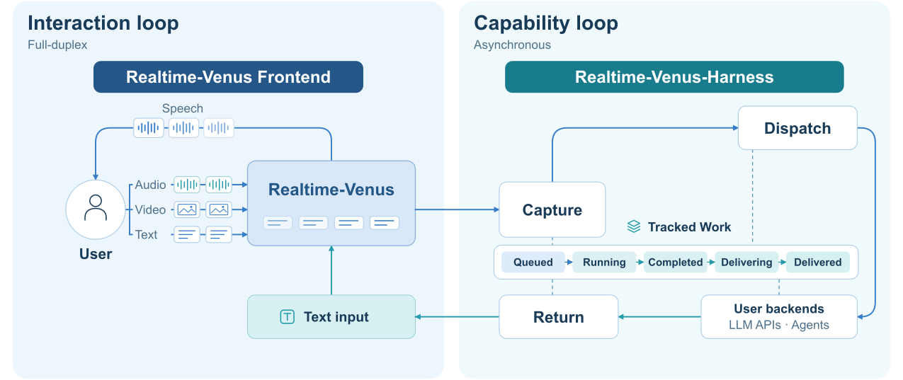
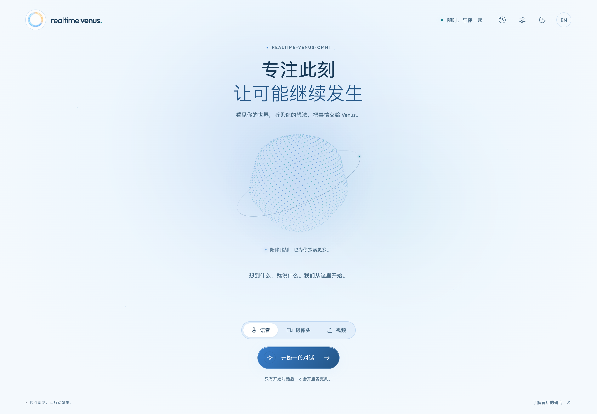

# Realtime-Venus Demo

[English](README.md) · **简体中文** · [项目总览](../README_ZH.md) · [Harness](../harness/README_ZH.md)

基于 Realtime-Venus-Omni 或 Realtime-Venus-Audio，以及 Codex 任务后端的网页 Demo。Audio 模式提供麦克风与音频上传；Omni 模式提供摄像头加麦克风与视频上传。

## 两个 loop，同一段对话

<p align="center"><br /><sub>论文<a href="https://arxiv.org/pdf/2609.13814">图 3</a>。Demo 启动时选择 Omni 或 Audio 作为交互前端。</sub></p>

**Interaction loop** 由所选前端模型处理流式媒体与语音；**Capability loop** 由 Harness 异步执行 `<delegate>...</delegate>` 请求，通过 `<backend>...</backend>` 回传结果，再由前端模型播报。

## 服务组成

| 组件 | 职责 | 实现入口 |
| --- | --- | --- |
| 浏览器 | 设备采集或视频上传、流式输入、语音播放、任务进度和产物下载。 | [`static/app.js`](static/app.js) |
| 网页服务 · 8032 | 接收 HTTP/WebSocket 请求，管理浏览器会话，组装模型与 Harness 连接。 | [`server/app.py`](server/app.py)、[`server/resources.py`](server/resources.py) |
| 会话 host | 排序媒体输入、消费模型输出、安排私有反馈、转交播放回执。 | [`server/session.py`](server/session.py)、[`VenusOmniServingHost`](../harness/bridge/host.py) |
| 模型服务 · 8031 | 加载权重、维护模型状态、执行流式推理并生成原生语音。 | [`model/server.py`](model/server.py)、[`model/adapter.py`](model/adapter.py) |
| Harness + Codex | 嵌入网页服务，执行任务、跟踪进度并回传结果。 | [`server/resources.py`](server/resources.py)、[Harness](../harness/README_ZH.md#架构) |
| 容器与配置 | 镜像、启动与配置持久化。 | [`deploy/`](../deploy/)、[`settings.py`](settings.py) |

模型服务跑在 GPU 服务器上，其余组件都跑在你的电脑上，通过网络（例如公司 VPN）与模型通信：模型接口是一条 WebSocket（`/session`），另有 `/healthz`、`/tokenizer`、`/stats` 三个 HTTP 接口。

<p align="center"><br /><sub>浏览器统一承载实时媒体、任务进度和结果下载。</sub></p>

## 准备

**GPU 服务器（模型）。** 配备 NVIDIA CUDA GPU 和可用驱动的 Linux 服务器，安装 Docker Engine（含 Compose）和 NVIDIA Container Toolkit（让容器能使用 GPU）。按[主 README](../README_ZH.md)在服务器上下载所选模式的完整权重，保留模型代码、tokenizer、参考音频及语音资产。默认下载到仓库根目录的 `Realtime-Venus-Omni/` 或 `Realtime-Venus-Audio/`，旁边是两种权重都要读取的 `config.yaml`；`deploy/model/.env.example` 中的 `MODEL_DIR` 默认就指向这个根目录。

**你的电脑（网页服务、Harness、任务执行器）。** macOS 或 Linux，安装 Docker Desktop 或 Docker Engine；不需要 GPU 和权重——tokenizer 从模型服务读取。任务执行器（Codex 或 Claude Code）需要网络，并在容器里登录一次。

<details>
<summary>权重目录示例</summary>

```text
Realtime-Venus-Omni/  # Or Realtime-Venus-Audio/
├── config.json
├── tokenizer.json / tokenizer_config.json
├── *.py                       # 随权重发布的模型代码
├── model.safetensors          # 或全部分片及其索引 JSON
└── assets/
    ├── HT_ref_audio.wav
    └── token2wav/
        ├── flow.yaml / flow.pt / hift.pt
        ├── campplus.onnx
        └── speech_tokenizer_v2_25hz.onnx
```

已有的 `model_weight/model_weight/` 嵌套布局也可识别。

</details>

## 启动

两边各是一个 Docker Compose 项目，用 `compose.yaml` 旁边的 `.env` 文件配置；所有字段见下方[配置文件](#配置文件)。

1. **GPU 服务器**，在 `deploy/model` 目录：`cp .env.example .env`，然后设置 `MODEL_TYPE`、`MODEL_DIR` 和 `VENUS_MODEL_TOKEN`（密钥用 `python3 -c "import secrets; print(secrets.token_urlsafe(24))"` 生成一次）。启动模型，第一次会构建镜像：

   ```bash
   docker compose up -d
   ```

   你的电脑必须能访问它的端口（`MODEL_PORT`，默认 8031）。在多人共用的服务器上，用 `chmod 600 .env` 保护这个文件。

2. **你的电脑**，在 `deploy/web` 目录：`cp .env.example .env`，然后把 `MODEL_URL` 设为服务器地址（例如 `http://10.194.99.8:8031`），`VENUS_MODEL_TOKEN` 设为同一个密钥。启动网页服务，再登录一次要用的任务执行器——Codex，或用 Claude 订阅账号登录 Claude Code：

   ```bash
   docker compose up -d
   ```

   ```bash
   docker compose exec web codex login --device-auth
   ```

   ```bash
   docker compose exec -it web claude auth login
   ```

   如果连不上模型服务、模型未就绪或令牌不对，网页容器会退出，原因写在 `docker compose logs` 里，并自动重启，直到模型可用。容器重启期间，改用 `docker compose run --rm --entrypoint sh web -c 'mkdir -p "$CODEX_HOME" && codex login --device-auth'`（Codex）或 `docker compose run --rm -it --entrypoint sh web -c 'mkdir -p "$CLAUDE_CONFIG_DIR" && claude auth login'`（Claude Code）登录。

**两端在同一台机器上：** 网页容器里的 `127.0.0.1` 指容器自己，所以 `MODEL_URL` 要设为 `http://host.docker.internal:8031`（Docker Desktop）或这台机器自己的地址。

## 在本地电脑打开

打开 **[http://localhost:8032](http://localhost:8032)**，开始会话。

| 输入模式 | 如何体验 |
| --- | --- |
| **语音** | 允许麦克风访问，通过本地扬声器收听。 |
| **摄像头** | 同时共享摄像头和麦克风，网页显示实时预览。 |
| **视频** | 选择视频模式并上传本地文件，上限 **200 MB**。视频音轨与采样画面会流式送入模型。 |

侧边任务面板支持查看进度、取消任务和下载产物。

模型同一时间支持**一个活跃会话**。网页服务断开后，模型保留这个会话 60 秒，等它重连接回；这期间如果网页服务重启后新开会话，旧会话立即让位。网页只发布在 `127.0.0.1` 上，浏览器信任它使用摄像头和麦克风。

**延迟。** 输入不等回复、输出由模型推送，网络往返只让回复整体晚到一个往返的时间，不影响说话的节奏。连接中断时页面会提示，45 秒内恢复就接着原来的对话。可在本地用 `curl -s -o /dev/null -w '%{time_total}\n' http://10.194.99.8:8031/healthz` 测量（地址换成你的 `MODEL_URL`）。

## 配置

### 配置文件

**模型服务**（`deploy/model/.env`）：

| 字段 | 默认值 | 作用 |
| --- | --- | --- |
| `MODEL_TYPE` | `omni` | `omni`：摄像头加麦克风、视频上传；`audio`：麦克风、音频上传。 |
| `MODEL_DIR` | —（必填） | 下载根目录，包含 `config.yaml` 和权重子目录；服务按 `MODEL_TYPE` 选用对应子目录。相对路径以 `./` 或 `../` 开头、相对 `deploy/model`（不写前缀时 Compose 会建一个空的命名卷）。以只读方式挂载。 |
| `REFERENCE_AUDIO` | `assets/HT_ref_audio.wav` | 参考音色，相对所选的权重目录。 |
| `MODEL_PORT` | `8031` | 你的电脑访问模型时用的端口。 |
| `MEMORY_MINUTES` | `40` | Omni 视频记忆时长（分钟）；Audio 不使用。 |
| `GPU_DEVICE` | `0` | 使用哪块 GPU。 |
| `VENUS_MODEL_TOKEN` | —（必填） | 共享密钥；除 `/healthz` 外的每个请求（包括 WebSocket 握手）都必须带上它。 |
| `PYTHON_IMAGE` / `PIP_INDEX_URL` | `python:3.11.18-slim-trixie@sha256:6737…` / PyPI | 构建用的基础镜像和包索引；需要时改成镜像源。 |

**网页服务**（`deploy/web/.env`）：

| 字段 | 默认值 | 作用 |
| --- | --- | --- |
| `MODEL_URL` | —（必填） | 模型服务地址，例如 `http://10.194.99.8:8031`。启动时从这里读取模型类型和 tokenizer。 |
| `VENUS_MODEL_TOKEN` | —（必填） | 与模型服务相同的密钥。 |
| `WEB_PORT` | `8032` | 网页地址为 `http://localhost:<WEB_PORT>`，只对本机开放。 |
| `MODEL_TIMEOUT_S` | `180` | 开会话、关会话时等待模型的上限（秒）。 |
| `DATA_DIR` | `./data` | 设置（`harness.json`）、执行器登录（`codex/`、`claude/`）和任务文件。相对路径以 `./` 开头、相对 `deploy/web`。 |
| `GEMINI_API_KEY` | 空 | 可选的官方 Gemini 密钥，也可以在 Settings 中填写。 |
| `PYTHON_IMAGE` / `PIP_INDEX_URL` | `python:3.11.18-slim-trixie@sha256:6737…` / PyPI | 构建用的基础镜像和包索引。 |

修改 `.env` 后，在同一目录运行 `docker compose up -d` 生效。切换模式时，在服务器上修改 `MODEL_TYPE`（另一种权重须已下载到同一根目录）并运行 `docker compose up -d`，再在 `deploy/web` 运行 `docker compose restart`，让网页服务读取新的模型类型。

**Harness 设置**（`deploy/web/data/harness.json`）在网页 Settings 第一次保存时写入，初始值来自独立包的[配置文件](../harness/config.json)。它包含任务执行器（`agent`：`codex` 或 `claude`，各有自己的 `codex` / `claude` 段；超时、看图和联网设置两者共用，放在 `codex` 段）、路由、Polish（`responses`）、multimodal、Gemini、任务目录、反馈间隔、执行／排队／结果等待时长、各组件预算以及发言长度；字段说明见 [Harness 文档](../harness/README_ZH.md#配置文件)，文件中的相对路径以 `deploy/web/data` 为基准。

网页容器内运行任务执行器的沙箱（两种执行器都用 bubblewrap；Claude Code 还通过 socat 转发网络流量），它需要 `compose.yaml` 中设置的 `seccomp=unconfined` 和 `systempaths=unconfined` 两个选项，否则所有任务命令都会失败。这两个选项削弱了容器本身的隔离（放开所有系统调用、不再遮蔽 `/proc`），因此镜像以非 root 用户运行，网页只接受 `localhost` / `127.0.0.1` 这两个主机名；任务命令仍由沙箱限制在任务目录内。这套配置在 macOS 的 Docker Desktop 上验证过。在 Linux 主机上，AppArmor 可能还会拦截沙箱（需要 `apparmor=unconfined`，未验证），并且 `DATA_DIR` 必须允许 uid 1000 写入。

### 网页设置

任务工作目录默认留空，用户需在 Settings 中填写任务目录后才能开始体验，例如填 `workspace`；相对路径保存在本机的 `deploy/web/data` 目录下。保存后再次打开 Settings 会显示用户自己配置的路径。不要提交或发布 `deploy/web/data/` 和两个 `.env` 文件，它们包含配置、密钥、执行器登录和任务文件。设置未完成时，选择语音、摄像头或视频会提示先完成 Settings；只检查当前选择的提供方所需配置。

开始对话前，网页和服务端 WebSocket 入口都会通过 `codex login status` 检查容器内的 Codex 登录状态。Settings 会显示结果；在 `deploy/web` 运行 `docker compose exec web codex login --device-auth` 登录后，可点击重新检查。未登录、检查失败或超过 5 秒超时都会阻止新会话，仍可保存配置。该检查确认 CLI 本地登录状态，不代表额度或远端服务可用性检查。

选择 **任务执行器：Claude Code** 时，改用 `claude auth status` 检查，只有 Claude 订阅登录才算通过（用 `docker compose exec -it web claude auth login` 登录）；API key 登录会显示“不是订阅登录”并阻止新会话。每次运行 Claude Code 都会从环境中删掉 `ANTHROPIC_*`、`CLAUDE_CODE_USE_*` 和 `CLAUDE_CODE_OAUTH_TOKEN`，不加载任何设置文件；CLI 先确认是订阅登录，否则拒绝运行。**请在 Claude 账号设置里保持“额外用量”（超出订阅额度后按量付费）为关闭状态：** CLI 要等一次请求已经完成才报告它用了额外用量，所以任务只能在第一次这样的请求之后停止，无法在它之前拦下。订阅额度用完时任务失败，助手会说明额度不足，不会切换到 Codex 或 API。自己使用自己的订阅没有问题；如果要把这项服务提供给别人用，请先查看 Anthropic 关于订阅登录用于第三方产品的条款。

主动播报任务进度默认关闭。在网页设置的“你的对话”中选择“开启：我同意接收语音进度反馈”，保存并开启新对话后生效；有新进展时才用一句话播报。关闭不影响任务执行、完成结果或主动询问进度。对应配置为 `feedback.proactive_progress`（布尔值，默认 `false`），保存在 `deploy/web/data/harness.json`；当前设置由此服务的用户共享。

请先结束当前对话再保存。任务参数和发言长度都写入 `deploy/web/data/harness.json`，下一次会话生效。未在网页暴露的 Harness 字段会保留。

| 设置项 | 默认值 | 作用 |
| --- | --- | --- |
| **任务模式** | General | 每个委托直接交给执行器，不调用路由模型。选择 Auto 后启用自动能力选择及任务续接。 |
| **任务执行器** | Codex | 由 Codex 或 Claude Code 执行所有后台任务，以及下面使用执行器的各环节；切换时这些环节一起改用所选执行器。 |
| **任务执行** | 执行器默认模型、`low` 强度 | 控制后台任务执行器。 |
| **Auto 路由** | 任务模型、`low`、30 秒 | 仅在 Auto 模式下使用。路由超时会终止该请求，不启动执行器。 |
| **Polish 进度／结果整理** | 任务执行器、任务模型、`low` | 可独立选择官方 Gemini；仍最多三句话。 |
| **Multimodal** | 任务执行器、任务模型、`low` | Auto 路由选择该能力时负责直接问答和多模态理解，可独立选择官方 Gemini。 |
| **发言长度** | `length_penalty = 0.8` | 小于 1 更倾向提前结束发言；1 保持原行为；大于 1 更倾向长发言。范围为 0.1–5。 |

执行器的模型名留空时，依次使用任务模型、执行器默认模型；Gemini 留空时使用下方的默认 Gemini 模型（初始为 `gemini-flash-latest`，可填写固定版本）。推理强度仅适用于执行器（Codex：`minimal`–`xhigh`；Claude Code：`low`–`max`），Gemini 使用其模型默认思考配置。旧配置中共用的直接问答参数会迁移到独立的 Multimodal 设置。

#### 使用官方 Gemini

1. 在网页“设置 → 任务连接 → 官方 Gemini 连接”填写 Google AI Studio API Key，或在 `deploy/web/.env` 中设置 `GEMINI_API_KEY` 后运行 `docker compose up -d`。
2. 分别为 Polish、Auto 路由、Multimodal 选择任务执行器或 Gemini，按需设置各自模型；选择 Gemini 后，该环节的文本或媒体将发送到 Google 官方 API。
3. 保存并开始新对话。默认任务模式仍为 General、所有提供方仍为任务执行器；路由和 Multimodal 只有在 Auto 路径中才会实际使用。General 工具执行器继续使用任务执行器，实时 Omni 模型不变。

密钥输入框留空表示保留已有密钥。网页配置接口只返回“已配置”状态；通过网页保存的密钥存于本机、权限为 `0600` 的 `deploy/web/data/harness.json`，不要提交到代码库。清除已存密钥时将文件中的 `gemini.api_key` 置空，同时检查本机环境变量。设置由该服务的用户共享。

实现固定调用 Google 的 [GenerateContent 官方接口](https://ai.google.dev/api/generate-content)，不接受自定义中转地址，不自动切换到其他提供方。Gemini 多模态输入使用委托时冻结的音频、视频片段或图像；内联请求超过 20 MB 会明确报错，需要缩短媒体窗口。实际可用模型、配额和地区由 API Key 所属项目决定。

## 服务管理

在服务器的 `deploy/model` 或你电脑的 `deploy/web` 目录运行：

```bash
docker compose up -d       # 需要时构建镜像，并在后台启动
docker compose ps          # 查看状态与健康检查
docker compose logs -f     # 跟踪日志（模型加载与推理 / 网页会话与 Codex）
docker compose restart     # 另一端变更后重启
docker compose down        # 停止并删除容器
```

更新代码后用 `docker compose up -d --build` 重新构建。除非用 `docker compose down` 停止，容器会自动重启。

| 位置 | 内容 |
| --- | --- |
| `deploy/web/data/harness.json` | 保存的任务、提供方和发言长度设置，包括 Gemini 密钥。 |
| `deploy/web/data/codex/` | Codex 登录与会话状态。 |
| `deploy/web/data/claude/` | Claude Code 登录与会话状态。 |
| `deploy/web/data/<任务目录>/` | 任务文件。生成文件在会话结束后仍保留；网页下载链接只在对应会话内有效。 |

### 容量测量

模型服务在 `/stats` 报告自己的测量值，访问时需要带令牌：

```bash
curl -s -H "Authorization: Bearer $VENUS_MODEL_TOKEN" http://10.194.99.8:8031/stats
```

| 字段 | 含义 |
| --- | --- |
| `gpu_memory_after_load.allocated_mib` | 刚加载完时的显存：每个实例都会重复占用的权重。 |
| `gpu_memory.peak_allocated_mib` | 当前这段对话开始以来的峰值。减去上一项，就是一段对话自己的状态（缓存、视频记忆）。 |
| `gpu_memory.device_used_mib` / `device_total_mib` | 整张 GPU 的占用，包括其他实例。 |
| `steps.p50_ms` / `p95_ms` / `max_ms` | 最近 600 步（约 10 分钟）每步生成的耗时。每段对话每秒需要一步，所以共用一张 GPU 的所有对话，步骤加起来必须在 1000 毫秒内完成。 |

测量方法：

1. 一张 GPU 跑一个实例：进行一段 10 分钟的摄像头对话，结束时读取 `/stats`。
2. 同一张 GPU 跑两个实例：在 `deploy/model` 目录用 `MODEL_PORT=8033 docker compose -p realtime-venus-model-2 up -d` 启动第二个实例。在你的电脑上，把 `deploy/web/data` 复制为 `deploy/web/data2`（带上设置和 Codex 登录），再用 `WEB_PORT=8034 MODEL_URL=http://10.194.99.8:8033 DATA_DIR=./data2 docker compose -p realtime-venus-web-2 up -d` 启动第二个网页服务。同时进行两段对话（http://localhost:8032 和 http://localhost:8034），分别读取 8031 和 8033 端口的 `/stats`。
3. 比较两次的 `p95_ms`，记下两个显存数字。测完用 `docker compose -p realtime-venus-model-2 down` 和 `docker compose -p realtime-venus-web-2 down` 停掉第二组。
